# Решение домашнего задания к занятию 5. «Практическое применение Docker»

### Инструкция к выполнению

1. Для выполнения заданий обязательно ознакомьтесь с [инструкцией](https://github.com/netology-code/devops-materials/blob/master/cloudwork.MD) по экономии облачных ресурсов. Это нужно, чтобы не расходовать средства, полученные в результате использования промокода.
3. **Своё решение к задачам оформите в вашем GitHub репозитории.**
4. В личном кабинете отправьте на проверку ссылку на .md-файл в вашем репозитории.
5. Сопроводите ответ необходимыми скриншотами.

---
## Примечание: Ознакомьтесь со схемой виртуального стенда [по ссылке](https://github.com/netology-code/shvirtd-example-python/blob/main/schema.pdf)

---

## Задача 0
1. Убедитесь что у вас НЕ(!) установлен ```docker-compose```, для этого получите следующую ошибку от команды ```docker-compose --version```
```
Command 'docker-compose' not found, but can be installed with:

sudo snap install docker          # version 24.0.5, or
sudo apt  install docker-compose  # version 1.25.0-1

See 'snap info docker' for additional versions.
```
В случае наличия установленного в системе ```docker-compose``` - удалите его.  
2. Убедитесь что у вас УСТАНОВЛЕН ```docker compose```(без тире) версии не менее v2.24.X, для это выполните команду ```docker compose version```  
###  **Своё решение к задачам оформите в вашем GitHub репозитории!!!!!!!!!!!!!!!!!!!!!!!!!!!!!!!!**

---

## Задача 1
1. Сделайте в своем GitHub пространстве fork [репозитория](https://github.com/netology-code/shvirtd-example-python).

2. Создайте файл ```Dockerfile.python``` на основе существующего `Dockerfile`:
   - Используйте базовый образ ```python:3.12-slim```
   - Обязательно используйте конструкцию ```COPY . .``` в Dockerfile
   - Создайте `.dockerignore` файл для исключения ненужных файлов
   - Используйте ```CMD ["uvicorn", "main:app", "--host", "0.0.0.0", "--port", "5000"]``` для запуска
   - Протестируйте корректность сборки
2.1 Используйте multistage сборку вместо single stage.
3. (Необязательная часть, *) Изучите инструкцию в проекте и запустите web-приложение без использования docker, с помощью venv. (Mysql БД можно запустить в docker run).
4. (Необязательная часть, *) Изучите код приложения и добавьте управление названием таблицы через ENV переменную.

### Решение
1. Решение оформлено в fork [репозитория](https://github.com/netology-code/shvirtd-example-python) - [shvirtd-example-python-](https://github.com/robotrainer/shvirtd-example-python-)
2. Создан файл `Dockerfile.python` с использованием multistage сборки:
   - собран образ `docker build -f Dockerfile.python -t shvirtd-example-python:multy .`
   - создана сеть для связи контейнера `python`-приложения с контейнером `MySQL` базой данных `docker network create shvirtd-net`
   - запускаем контейнер с `MySQL` базой данных `docker run -d --name mysql-shvirtd --network shvirtd-net -p 3306:3306 --env-file .env mysql:latest`
   - ждём, когда поднимется контейнера с `MySQL` базой данных и только потом запускаем конетйнер `python`-приложения `docker run -d --name shvirtd-example-python --network shvirtd-net -p 5000:5000 -e DB_HOST=mysql-shvirtd --env-file .env.python shvirtd-example-python:multy`
   - настройки контейнеров берутся из ENV переменных, которые передаются в контейнеры из файлов: `.env` - `MySQL` базой данных, `.env.python` - `python`-приложениe
   - по запросу `curl http://localhost:5000` получим от сервера предупреждение о неправильном порту, значит, что приложение успешно запущено, но без proxy-сервера

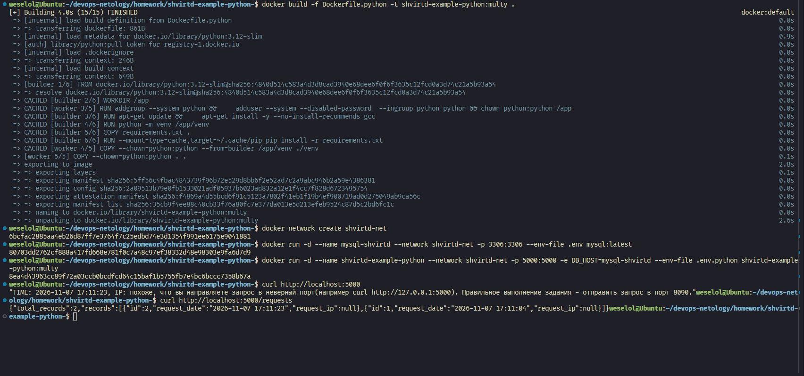

3. Запуск `python`-приложениe локально

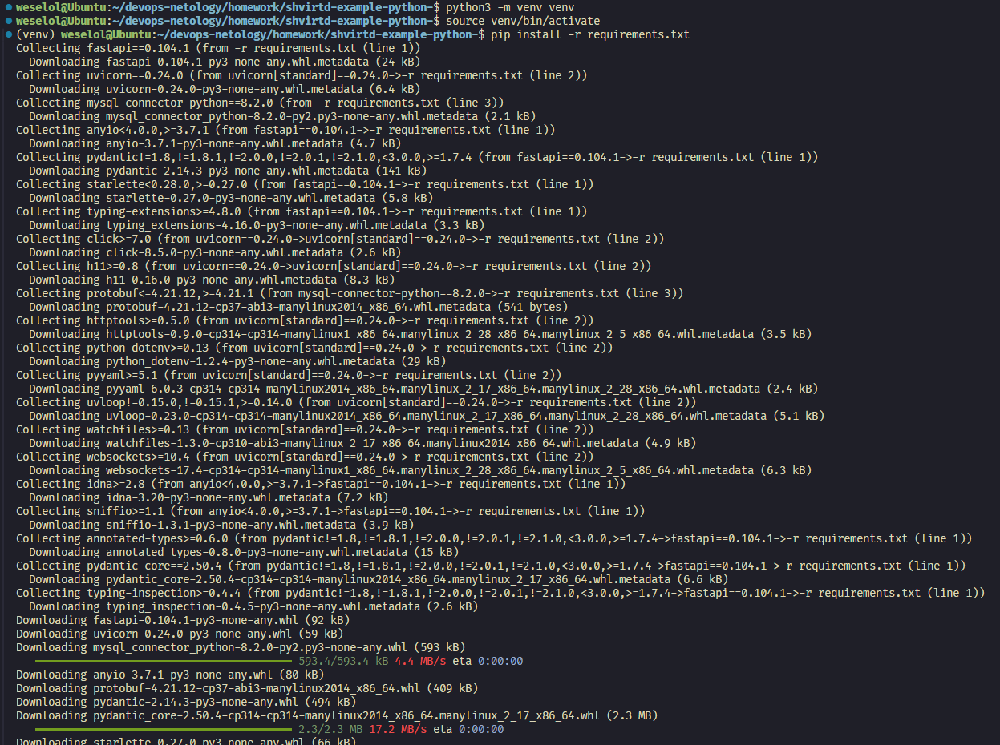

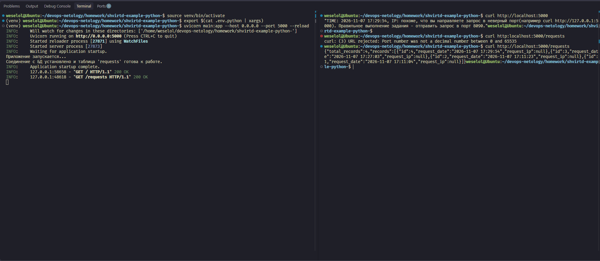

При выполнении `curl http://localhost:5000` получаем тот же результат, предупреждение о неправильном порте. Также видны логи сервера об выполненнии запросов.

---
### ВНИМАНИЕ!
!!! В процессе последующего выполнения ДЗ НЕ изменяйте содержимое файлов в fork-репозитории! Ваша задача ДОБАВИТЬ 5 файлов: ```Dockerfile.python```, ```compose.yaml```, ```.gitignore```, ```.dockerignore```,```bash-скрипт```. Если вам понадобилось внести иные изменения в проект - вы что-то делаете неверно!
---

## Задача 2 (*)
1. Создайте в yandex cloud container registry с именем "test" с помощью "yc tool" . [Инструкция](https://cloud.yandex.ru/ru/docs/container-registry/quickstart/?from=int-console-help)
2. Настройте аутентификацию вашего локального docker в yandex container registry.
3. Соберите и залейте в него образ с python приложением из задания №1.
4. Просканируйте образ на уязвимости.
5. В качестве ответа приложите отчет сканирования.

### Решение

1. В Yandex Cloud был создан новый каталог и в нём командой `yc container registry create --name weselol-registry --folder-id <идентификатор_каталога>` новый container registry
2. Была найтроена аутентификацию локального docker командой `yc container registry configure-docker`
3. Был собран и залит образ `python`-приложения командой `docker push cr.yandex/<идентификатор_реестра>/shvirtd-example-python:multy`
4. Был просканирован образ на уязвимости: всего найдено 189 уязвимостей
5. Результат сканирования

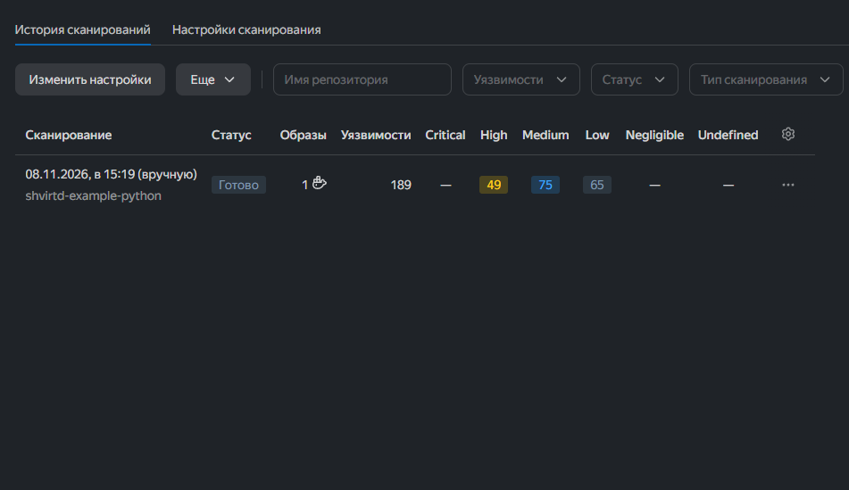

## Задача 3
1. Изучите файл "proxy.yaml"
2. Создайте в репозитории с проектом файл ```compose.yaml```. С помощью директивы "include" подключите к нему файл "proxy.yaml".
3. Опишите в файле ```compose.yaml``` следующие сервисы: 

- ```web```. Образ приложения должен ИЛИ собираться при запуске compose из файла ```Dockerfile.python``` ИЛИ скачиваться из yandex cloud container registry(из задание №2 со *). Контейнер должен работать в bridge-сети с названием ```backend``` и иметь фиксированный ipv4-адрес ```172.20.0.5```. Сервис должен всегда перезапускаться в случае ошибок.
Передайте необходимые ENV-переменные для подключения к Mysql базе данных по сетевому имени сервиса ```web``` 

- ```db```. image=mysql:8. Контейнер должен работать в bridge-сети с названием ```backend``` и иметь фиксированный ipv4-адрес ```172.20.0.10```. Явно перезапуск сервиса в случае ошибок. Передайте необходимые ENV-переменные для создания: пароля root пользователя, создания базы данных, пользователя и пароля для web-приложения.Обязательно используйте уже существующий .env file для назначения секретных ENV-переменных!

2. Запустите проект локально с помощью docker compose , добейтесь его стабильной работы: команда ```curl -L http://127.0.0.1:8090``` должна возвращать в качестве ответа время и локальный IP-адрес. Если сервисы не стартуют воспользуйтесь командами: ```docker ps -a ``` и ```docker logs <container_name>``` . Если вместо IP-адреса вы получаете информационную ошибку --убедитесь, что вы шлете запрос на порт ```8090```, а не 5000.

5. Подключитесь к БД mysql с помощью команды ```docker exec -ti <имя_контейнера> mysql -uroot -p<пароль root-пользователя>```(обратите внимание что между ключем -u и логином root нет пробела. это важно!!! тоже самое с паролем) . Введите последовательно команды (не забываем в конце символ ; ): ```show databases; use <имя вашей базы данных(по-умолчанию virtd, как это указано в .env)>; show tables; SELECT * from requests LIMIT 10;```. Примечание: таблица в БД создается после первого поступившего запроса к приложению.

6. Остановите проект. В качестве ответа приложите скриншот sql-запроса.

### Решение

`python`-приложениу запущено с помощью созданного `compose.yaml`. Также добавлен `volumes` для сохранения данных после `docker compose down`.

Результат выполнения `sql`-запроса:

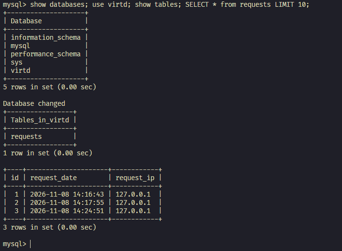

## Задача 4
1. Запустите в Yandex Cloud ВМ (вам хватит 2 Гб Ram).
2. Подключитесь к Вм по ssh и установите docker.
3. Напишите bash-скрипт, который скачает ваш fork-репозиторий в каталог /opt и запустит проект целиком.
4. Зайдите на сайт проверки http подключений, например(или аналогичный): ```https://check-host.net/check-http``` и запустите проверку вашего сервиса ```http://<внешний_IP-адрес_вашей_ВМ>:8090```. Таким образом трафик будет направлен в ingress-proxy. Трафик должен пройти через цепочки: Пользователь → Internet → Nginx → HAProxy → FastAPI(запись в БД) → HAProxy → Nginx → Internet → Пользователь
5. (Необязательная часть) Дополнительно настройте remote ssh context к вашему серверу. Отобразите список контекстов и результат удаленного выполнения ```docker ps -a```
6. Повторите SQL-запрос на сервере и приложите скриншот и ссылку на fork.

### Решение

1. Была создана Yandex Cloud ВМ с минимальными характеристиками с Ubuntu ОС.
2. Был установлен docker согласно документации https://docs.docker.com/engine/install/ubuntu/
3. Был написан скрипт `deploy.sh`, при запуске которого клонируется fork-репозиторий в каталог /opt и запустит проект целиком. Перед запуском `deploy.sh` необходимо рядом со скриптом создать файл `.env` с необходимыми для проекта переменными окружения.
4. С помощью `https://check-host.net/check-http` была проверена доступность сервиса на ВМ по порту 8090.
5. -
6. Ссылка на fork - https://github.com/robotrainer/shvirtd-example-python-

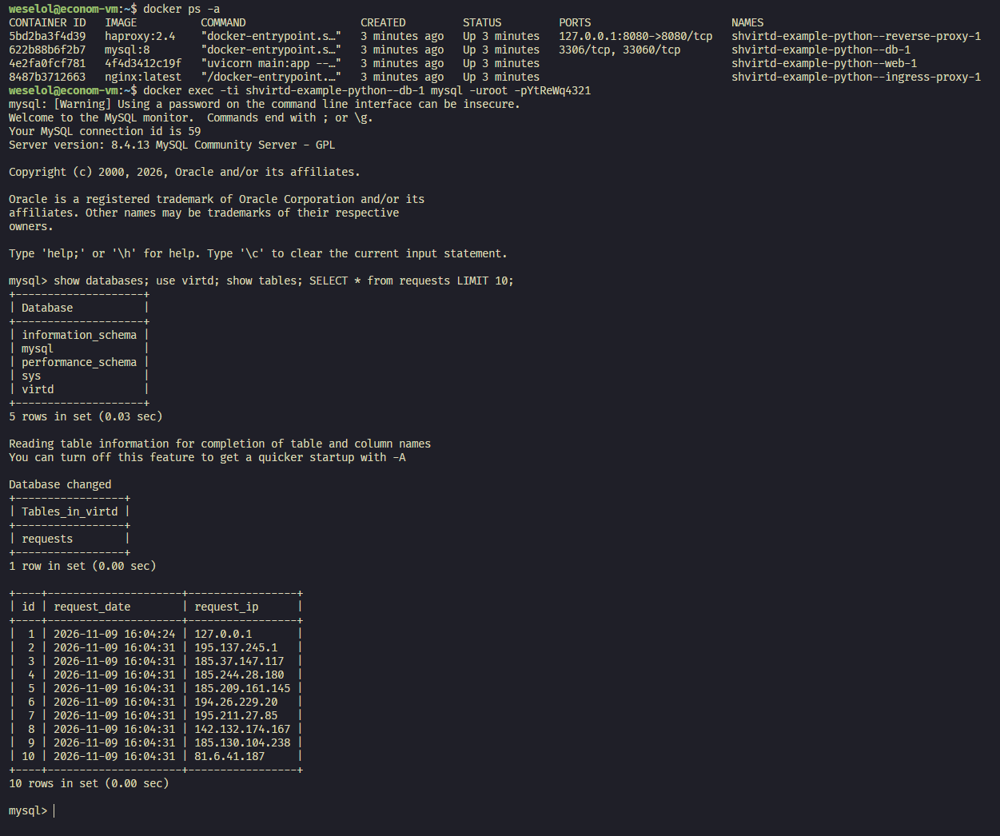

## Задача 5 (*)
1. Напишите и задеплойте на вашу облачную ВМ bash скрипт, который произведет резервное копирование БД mysql в директорию "/opt/backup" с помощью запуска в сети "backend" контейнера из образа ```schnitzler/mysqldump``` при помощи ```docker run ...``` команды. Подсказка: "документация образа."
2. Протестируйте ручной запуск
3. Настройте выполнение скрипта раз в 1 минуту через cron, crontab или systemctl timer. Придумайте способ не светить логин/пароль в git!!
4. Предоставьте скрипт, cron-task и скриншот с несколькими резервными копиями в "/opt/backup"

### Решение

1. Был написан скрипт скрипт `backup.sh`, который производит резвервное копирование БД mysql в директорию `/opt/backup`. Контейнер `schnitzler/mysqldump` был заменён на `mysql:8`, т.к. он уже давно не обновлялся и в нём не поддерживается плагин аутентификации `caching_sha2_password`, используемый по умолчанию в `mysgl:8`.
2. Скрипт был протестирован вручную.
3. Была выполнена настройка `crontab` и запущена задача `* * * * * /opt/shvirtd-example-python-/backup.sh >> /var/log/mysql_backup.log 2>&1`, которая каждую минуту запускает скрипт `backup.sh` и записывает логи в `/var/log/mysql_backup.log`.
4. Скриншот с несколькими резервными копиями в "/opt/backup". Видно, что размер меняется от зависимости совершённых запросов на `http://<внешний_IP-адрес_ВМ>:8090`.

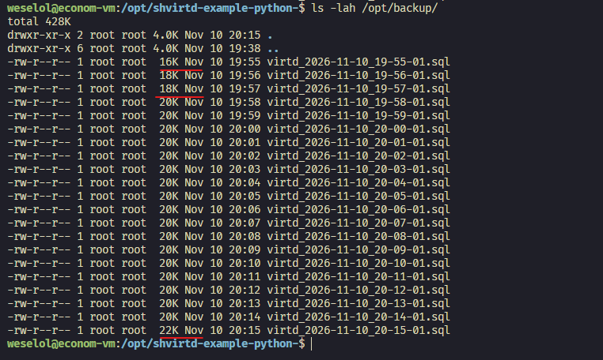

## Задача 6
Скачайте docker образ ```hashicorp/terraform:latest``` и скопируйте бинарный файл ```/bin/terraform``` на свою локальную машину, используя dive и docker save.
Предоставьте скриншоты  действий .

### Решение

1. Скачен `dive` и образ `hashicorp/terraform:latest`

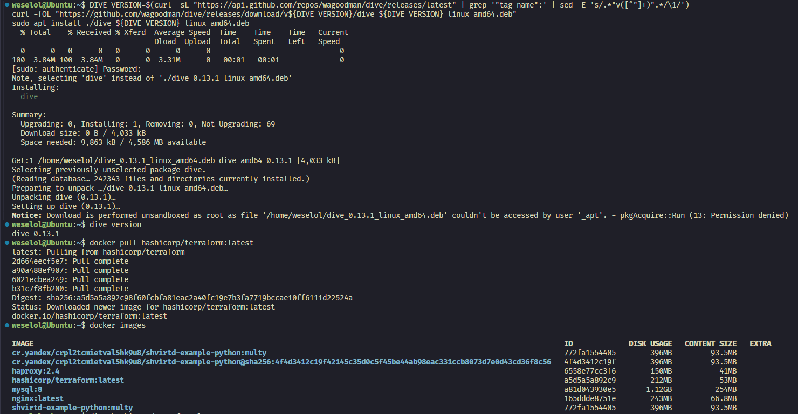

2. Запущена команда `dive hashicorp/terraform:latest` и исследованы слои образа, так же образ сохранён локально в виде архива `image.tar.gz`

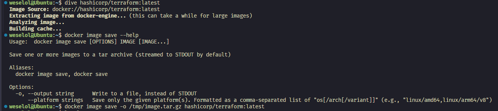

3. Исследование слоёв образа. Видно, что в последнем слое находится искомый бинарник `/bin/terraform` с размером 129 МБ. Это важно, т.к. это позволяет предположить, что искомый нами слой будет самый "тяжёлый"

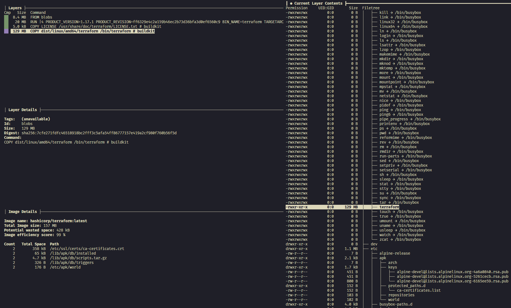

4. Распаковка архива образа и получение дериктории `blobs`

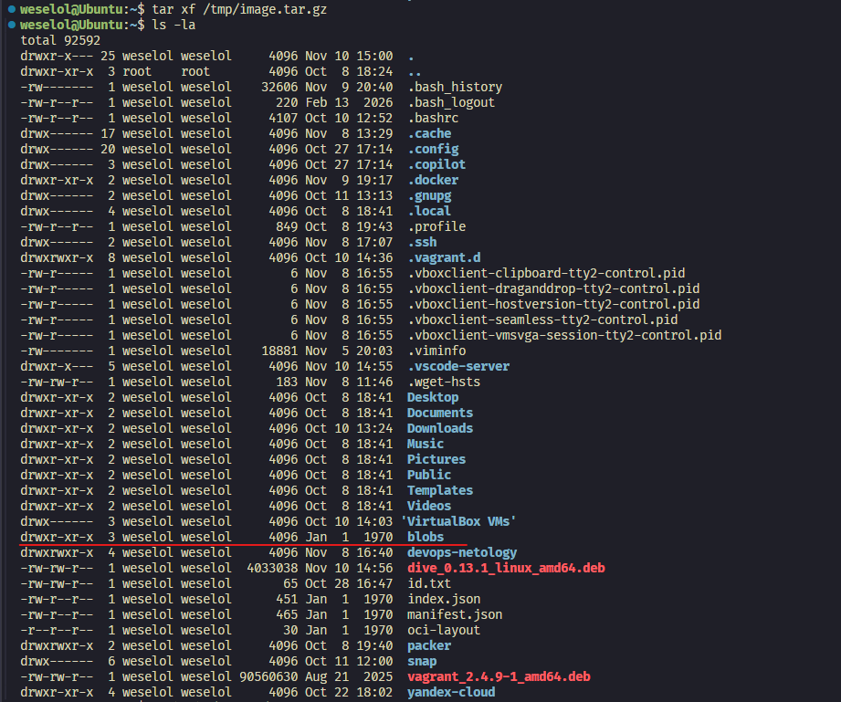

5. Находим самый "тяжёловесный" слой и распаковываем его. Предположение оказалось верным, это и есть искомы бинарник `/bin/terraform`

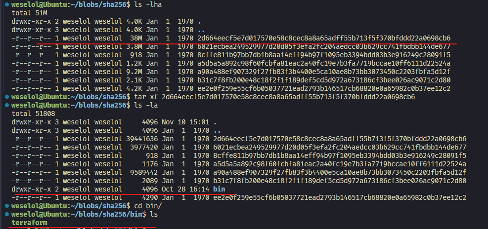